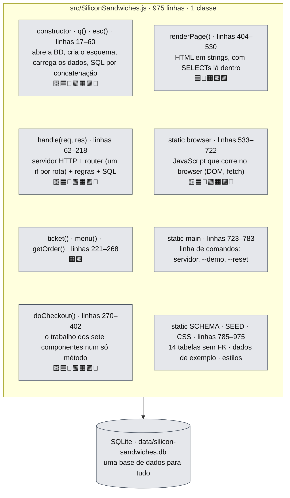
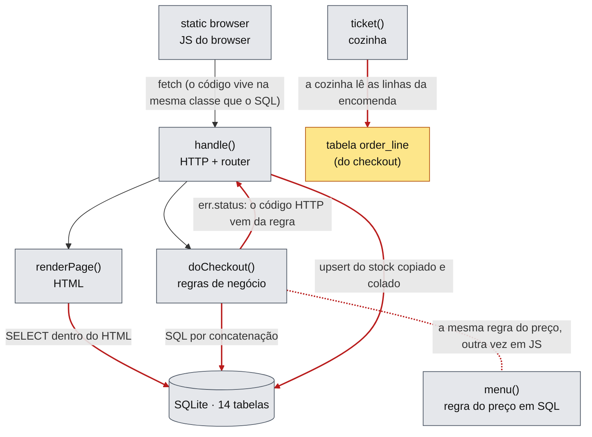
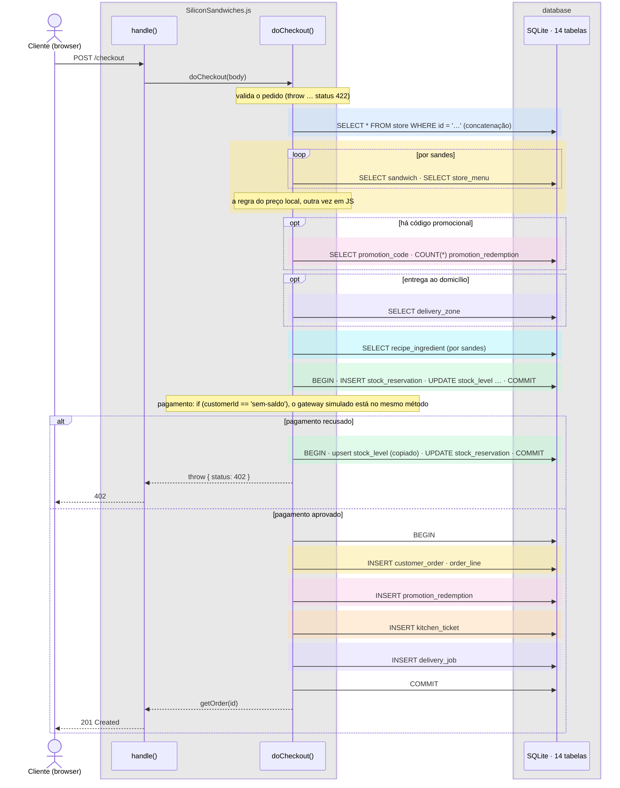
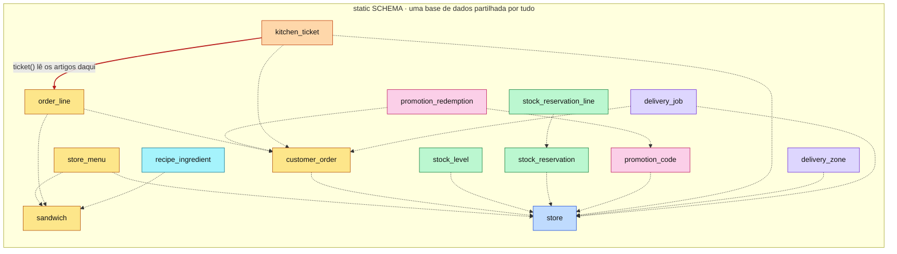

#fcul

# Silicon Sandwiches · Big Ball of Mud · diagramas de arquitetura

Quatro vistas do código em `big-ball-of-mud/`, na mesma ordem e com as mesmas cores de [Arquitetura - Layered](../../layered/spec/Arquitetura%20-%20Layered.md) e [Arquitetura - Modular](../../modular/spec/Arquitetura%20-%20Modular.md), para as comparar lado a lado.

- **Mermaid** (esta nota): vê-se diretamente no Obsidian, no GitHub e no VS Code.
- **draw.io**: `Arquitetura - Big Ball of Mud.drawio`, nesta pasta, com as mesmas quatro vistas em quatro páginas. É a versão para editar.

**Cor = componente do kata**, igual em todas as versões:

| Cor | Componente |
|---|---|
| 🟨 amarelo | CatalogCheckout |
| 🟦 azul | Location |
| 🩷 rosa | Promotion |
| 🟩 verde | ManageInventory |
| 🟧 laranja | MakeOrder |
| 🟪 roxo | Delivery |
| 🩵 ciano | Recipes |
| ⬜ cinzento | técnico / partilhado |

Aqui, as cores não têm onde ficar: os componentes do kata não existem no código. As caixas são cinzentas e os quadrados ao lado dizem que componentes cada parte da classe mexe.

---

## 1 · Particionamento de topo

**Não há** particionamento. A pasta `src/` tem um ficheiro, e o ficheiro tem uma classe com 975 linhas. A classe está dividida por posição (lê-se coluna a coluna, pelos números das linhas), não por responsabilidade: quase todas as partes tocam em quase todas as cores.

Fora da classe ficam só os testes (`test/checkout.test.js`, os 9 de sempre) e `scripts/check-mud.js`.

> **Perguntar:** "Quero mudar a forma como se calcula a taxa de entrega e guardar mais um campo. Quantas pastas abro?" → Uma pasta e um ficheiro, mas pelo menos quatro sítios desse ficheiro: o `SCHEMA` (a coluna), o `doCheckout()` (a regra), o `handle()` (o `GET /deliveries` e o `POST /deliveries/:id/advance` mapeiam as colunas à mão, duas vezes) e o `renderPage()` (o `SELECT` da página). Nada no código diz que são estes quatro: é preciso procurar.

---

## 2 · Regras de dependência

**Não há regras para verificar.** Qualquer linha da classe pode usar qualquer outra e qualquer tabela. `scripts/check-mud.js` (`npm run check:arch`) conta, em vez disso, quantas responsabilidades diferentes vivem no mesmo ficheiro, e falha sempre:

| Responsabilidade | Ocorrências em `SiliconSandwiches.js` |
|---|---|
| HTTP (pedidos e respostas) | 4 |
| Router (rotas) | 16 |
| HTML | 221 |
| CSS | 69 |
| JavaScript do browser (DOM) | 8 |
| Regras de negócio | 32 |
| SQL | 77 |
| Dados de exemplo | 18 |
| Linha de comandos | 5 |

`✘ 9 responsabilidades no mesmo ficheiro: não há fronteiras para verificar.` (Resultado de correr o script.)

O diagrama mostra os atalhos assinalados no código com `LAMA:`. Cada seta vermelha é uma dependência que, no Layered ou no Modular, o `check:arch` rejeitava.

> **Perguntar:** "Se o código funciona e passa nos mesmos 9 testes, qual é o problema?" → Os testes dizem o que o sistema faz, não o custo de o mudar. Sem fronteiras, cada mudança obriga a abrir, perceber e testar a classe inteira. E as regras duplicadas (o preço em SQL e em JavaScript, a máquina de estados no servidor e no browser) divergem sem que nenhum teste dê por isso.

---

## 3 · Sequência do checkout

`POST /checkout` entra em `handle()` e corre todo dentro de `doCheckout()`, que vai diretamente às tabelas. Não há serviços nem repositórios: as faixas coloridas mostram de que componente do kata é cada passo, mas no código são só linhas seguidas do mesmo método.

> **Perguntar:** "Comparem com a mesma sequência no Layered e no Modular. Os passos mudam?" → Não: são os mesmos oito passos, pela mesma ordem. O que muda é que não há ninguém do outro lado da seta. A encomenda, o código usado, o bilhete e a entrega são gravados numa só transação "porque está tudo à mão" (`LAMA:` na linha 372). É cómodo, mas torna impossível separar o Delivery ou a cozinha mais tarde sem reescrever o método.

---

## 4 · Dados

Um só `static SCHEMA`, com **14 tabelas e nenhuma chave estrangeira**. As relações existem (as mesmas do Layered), mas são só ids guardados (a tracejado): a base de dados não garante nenhuma. Falta a `kitchen_ticket_item`: a cozinha lê diretamente `order_line`, a tabela do checkout (a vermelho). As contagens são minhas, feitas a partir do `SCHEMA`.

| | Layered | Modular | Big Ball of Mud |
|---|---|---|---|
| Esquemas | 1 | 7 (um por módulo) | 1, dentro da classe |
| Tabelas | 15 | 15 | 14 |
| Chaves estrangeiras | 18 | 6 | 0 |
| Quem pode ler cada tabela | qualquer repositório | só o módulo dono | qualquer linha da classe |

> **Perguntar:** "No Modular também se tiraram as FK entre componentes. Qual é a diferença?" → No Modular, tirar a FK foi uma decisão: cada tabela tem um dono e só ele lhe mexe (regra 3 do `check:arch`), e o código desse módulo garante a integridade. Aqui não há FK nem dono. A integridade não está em lado nenhum, e qualquer parte da classe pode escrever em qualquer tabela.
