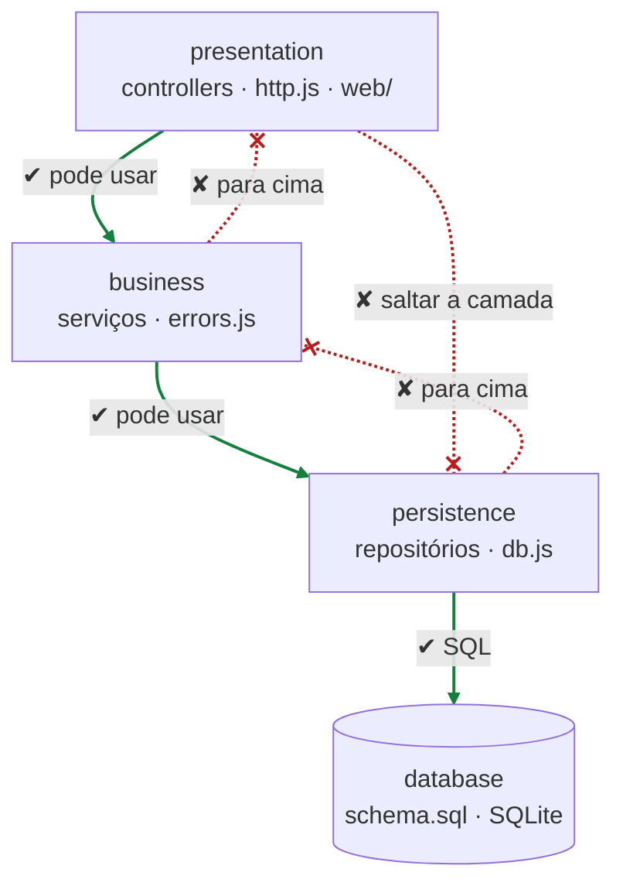
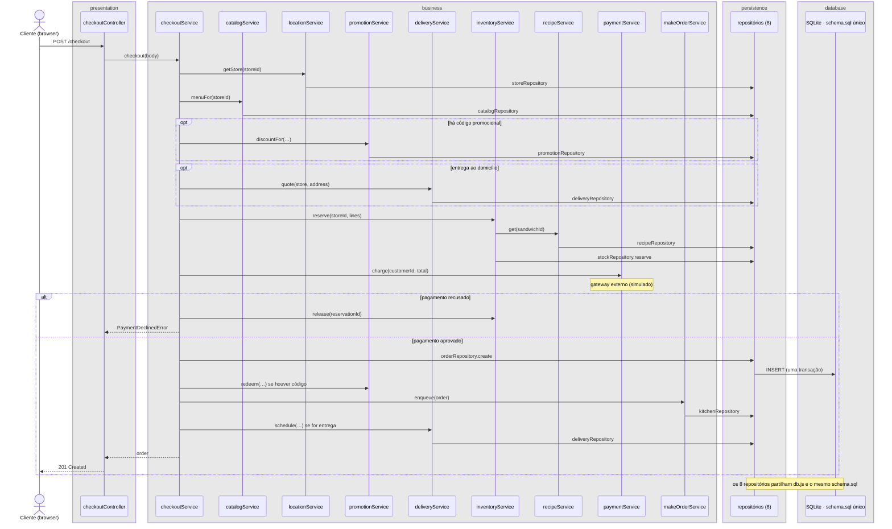
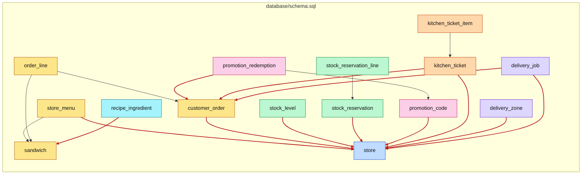

#fcul

# Silicon Sandwiches · Layered · diagramas de arquitetura

Quatro vistas do código em `layered/`, na mesma ordem e com as mesmas cores de [Arquitetura - Modular](../../modular/spec/Arquitetura%20-%20Modular.md), para as comparar lado a lado.

- **Mermaid** (esta nota): vê-se diretamente no Obsidian, no GitHub e no VS Code.
- **draw.io**: `Arquitetura - Layered.drawio`, nesta pasta, com as mesmas quatro vistas em quatro páginas. É a versão para editar.

**Cor = componente do kata**, igual nas duas versões:

| Cor | Componente |
|---|---|
| 🟨 amarelo | CatalogCheckout |
| 🟦 azul | Location |
| 🩷 rosa | Promotion |
| 🟩 verde | ManageInventory |
| 🟧 laranja | MakeOrder |
| 🟪 roxo | Delivery |
| 🩵 ciano | Recipes |
| ⬜ cinzento | técnico / partilhado |

---

## 1 · Particionamento de topo

O primeiro corte é **técnico**: as pastas de topo são camadas. Cada cor atravessa as quatro camadas. O checkout, por exemplo, está em `checkoutController`, em três serviços, em dois repositórios e no `schema.sql` comum.

```mermaid
flowchart TB
  subgraph P["presentation/"]
    direction LR
    p1["checkoutController"]:::cc
    p2["locationController"]:::loc
    p3["promotionController"]:::promo
    p4["inventoryController"]:::inv
    p5["makeOrderController"]:::mo
    p6["deliveryController"]:::del
    p7["recipeController"]:::rec
    p8["webController · http.js · web/"]:::tech
  end
  subgraph B["business/"]
    direction LR
    b1["checkoutService"]:::cc
    b2["catalogService"]:::cc
    b3["paymentService<br/>(gateway simulado)"]:::cc
    b4["locationService"]:::loc
    b5["promotionService"]:::promo
    b6["inventoryService"]:::inv
    b7["makeOrderService"]:::mo
    b8["deliveryService"]:::del
    b9["recipeService"]:::rec
    b10["errors.js · mockLog.js"]:::tech
  end
  subgraph R["persistence/"]
    direction LR
    r1["orderRepository"]:::cc
    r2["catalogRepository"]:::cc
    r3["storeRepository"]:::loc
    r4["promotionRepository"]:::promo
    r5["stockRepository"]:::inv
    r6["kitchenRepository"]:::mo
    r7["deliveryRepository"]:::del
    r8["recipeRepository"]:::rec
    r9["db.js"]:::tech
  end
  subgraph D["database/"]
    direction LR
    d1["schema.sql<br/>um só esquema com as 15 tabelas de todos os componentes"]:::tech
    d2["seed.sql"]:::tech
  end
  P --> B --> R --> D

  classDef cc fill:#FDE68A,stroke:#B45309,color:#111
  classDef loc fill:#BFDBFE,stroke:#1D4ED8,color:#111
  classDef promo fill:#FBCFE8,stroke:#BE185D,color:#111
  classDef inv fill:#BBF7D0,stroke:#15803D,color:#111
  classDef mo fill:#FED7AA,stroke:#C2410C,color:#111
  classDef del fill:#DDD6FE,stroke:#6D28D9,color:#111
  classDef rec fill:#A5F3FC,stroke:#0E7490,color:#111
  classDef tech fill:#E5E7EB,stroke:#4B5563,color:#111
```

Fora das camadas ficam `app.js` (a raiz de composição, que cria e liga tudo) e `server.js`.

> **Perguntar:** "Quero mudar a forma como se calcula a taxa de entrega e guardar mais um campo. Quantas pastas abro?" → Pelo menos três: `business/deliveryService.js`, `persistence/deliveryRepository.js` e `database/schema.sql`. Se a taxa aparecer no ecrã, também `presentation/`.

---

## 2 · Regras de dependência

As camadas são **fechadas**: cada camada só pode usar a própria e a imediatamente abaixo. É isto que `scripts/check-layers.js` verifica (`npm run check:arch`).

| Camada | Pode importar de |
|---|---|
| `presentation` | `presentation`, `business` |
| `business` | `business`, `persistence` |
| `persistence` | `persistence` |

Um exemplo de violação: `checkoutController.js` importar `../persistence/orderRepository.js`.

`app.js` fica **fora** das camadas. Cria os repositórios, os serviços e os *controllers*, e injeta cada um no de cima. Os *controllers* recebem os serviços; não os importam.

> **Perguntar:** "O `checkoutService` chama o `inventoryService`. É uma violação?" → Não. É uma dependência dentro da mesma camada, e a regra permite-a. Mas é também por aqui que os componentes se acoplam sem que a regra das camadas dê por isso.

---

## 3 · Sequência do checkout

`POST /checkout` desce camada a camada. O `checkoutService` orquestra os outros serviços de negócio e chama-os diretamente. Todos os repositórios vão ao mesmo esquema.

> **Perguntar:** "Comparem com a mesma sequência no Modular. Os passos mudam?" → Não: a sequência é a mesma. Muda **onde** está o código e **o que** o checkout consegue ver. Aqui, o `checkoutService` tem acesso a todos os serviços e, através deles, a todas as tabelas.

---

## 4 · Dados

Há um só `database/schema.sql`, com 15 tabelas e 18 chaves estrangeiras. **12 delas ligam tabelas de componentes diferentes** (a vermelho). Qualquer repositório pode fazer `JOIN` com qualquer tabela. As contagens são minhas, feitas a partir do `schema.sql`.

> **Perguntar:** "Amanhã queremos tirar o Delivery para um serviço à parte. O que se parte na base de dados?" → As FK `delivery_job → customer_order` e `delivery_job → store`, e também `delivery_zone → store`. Separar o código é a parte fácil; separar os dados é a difícil.
