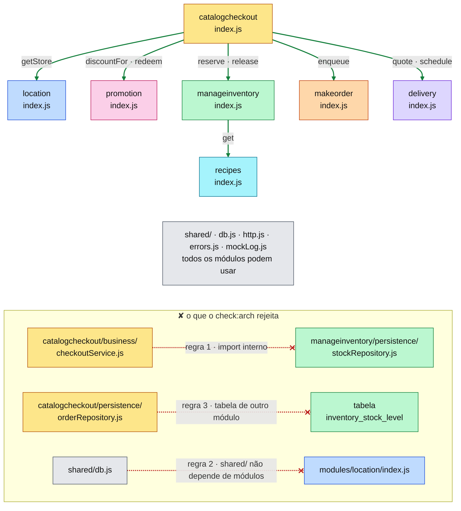
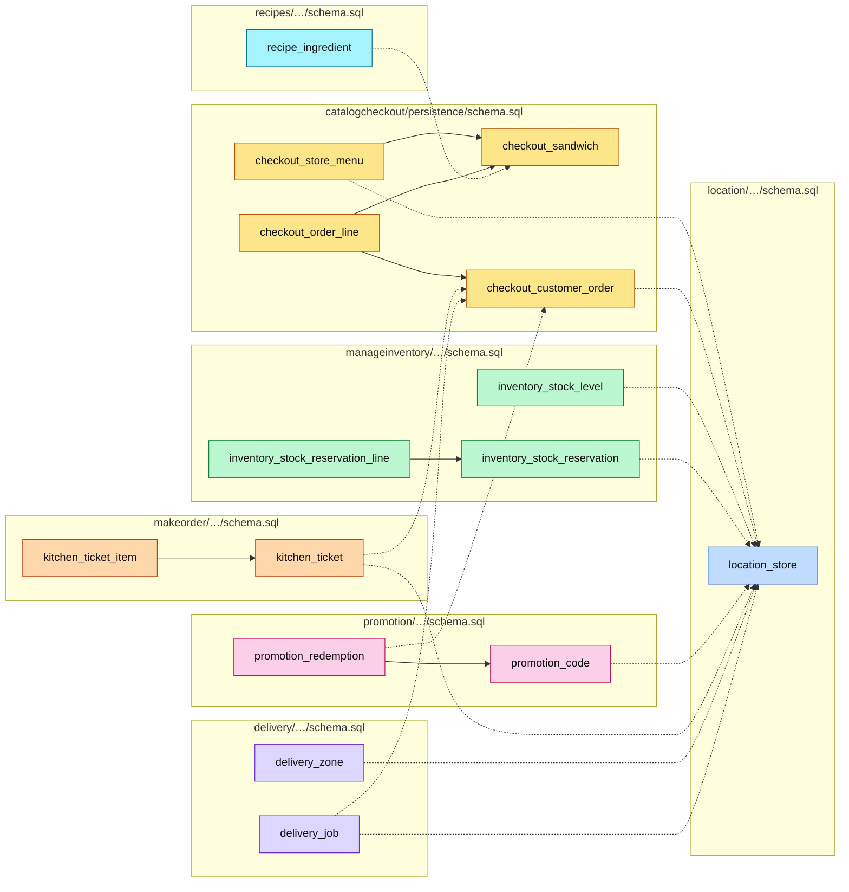

#fcul

# Silicon Sandwiches · Modular Monolith · diagramas de arquitetura

Quatro vistas do código em `modular/`, na mesma ordem e com as mesmas cores de [Arquitetura - Layered](../../layered/spec/Arquitetura%20-%20Layered.md), para as comparar lado a lado.

- **Mermaid** (esta nota): vê-se diretamente no Obsidian, no GitHub e no VS Code.
- **draw.io**: `Arquitetura - Modular.drawio`, nesta pasta, com as mesmas quatro vistas em quatro páginas. É a versão para editar.

**Cor = componente do kata**, igual nas duas versões:

| Cor | Componente / módulo |
|---|---|
| 🟨 amarelo | CatalogCheckout · `catalogcheckout/` |
| 🟦 azul | Location · `location/` |
| 🩷 rosa | Promotion · `promotion/` |
| 🟩 verde | ManageInventory · `manageinventory/` |
| 🟧 laranja | MakeOrder · `makeorder/` |
| 🟪 roxo | Delivery · `delivery/` |
| 🩵 ciano | Recipes · `recipes/` |
| ⬜ cinzento | técnico / partilhado |

---

## 1 · Particionamento de topo

O primeiro corte é **por domínio**: as pastas de topo são módulos, um por componente do kata. Cada cor fica dentro de uma caixa. As camadas técnicas continuam a existir, mas **dentro** de cada módulo.

```mermaid
flowchart TB
  app["app.js · raiz de composição: cria os módulos e liga-os pelas APIs públicas · server.js"]:::tech

  subgraph M["modules/"]
    direction LR
    subgraph cc["catalogcheckout/"]
      direction TB
      cc0["index.js · API pública<br/>checkout · getOrder · menuFor"]:::cc
      cc1["presentation/<br/>checkoutController"]:::cc
      cc2["business/<br/>checkoutService · catalogService · paymentService"]:::cc
      cc3["persistence/<br/>catalogRepository · orderRepository<br/>schema.sql (4 tabelas)"]:::cc
    end
    subgraph loc["location/"]
      direction TB
      loc0["index.js · API pública<br/>getStore"]:::loc
      loc1["presentation/<br/>locationController"]:::loc
      loc2["business/<br/>locationService"]:::loc
      loc3["persistence/<br/>storeRepository<br/>schema.sql (1 tabela)"]:::loc
    end
    subgraph promo["promotion/"]
      direction TB
      promo0["index.js · API pública<br/>discountFor · redeem"]:::promo
      promo1["presentation/<br/>promotionController"]:::promo
      promo2["business/<br/>promotionService"]:::promo
      promo3["persistence/<br/>promotionRepository<br/>schema.sql (2 tabelas)"]:::promo
    end
    subgraph inv["manageinventory/"]
      direction TB
      inv0["index.js · API pública<br/>reserve · release"]:::inv
      inv1["presentation/<br/>inventoryController"]:::inv
      inv2["business/<br/>inventoryService"]:::inv
      inv3["persistence/<br/>stockRepository<br/>schema.sql (3 tabelas)"]:::inv
    end
    subgraph mo["makeorder/"]
      direction TB
      mo0["index.js · API pública<br/>enqueue"]:::mo
      mo1["presentation/<br/>makeOrderController"]:::mo
      mo2["business/<br/>makeOrderService"]:::mo
      mo3["persistence/<br/>kitchenRepository<br/>schema.sql (2 tabelas)"]:::mo
    end
    subgraph del["delivery/"]
      direction TB
      del0["index.js · API pública<br/>quote · schedule"]:::del
      del1["presentation/<br/>deliveryController"]:::del
      del2["business/<br/>deliveryService"]:::del
      del3["persistence/<br/>deliveryRepository<br/>schema.sql (2 tabelas)"]:::del
    end
    subgraph rec["recipes/"]
      direction TB
      rec0["index.js · API pública<br/>get"]:::rec
      rec1["presentation/<br/>recipeController"]:::rec
      rec2["business/<br/>recipeService"]:::rec
      rec3["persistence/<br/>recipeRepository<br/>schema.sql (1 tabela)"]:::rec
    end
  end

  shared["shared/ · db.js · http.js · errors.js · mockLog.js<br/>código técnico comum; não depende de nenhum módulo"]:::tech
  web["web/ · webController.js · public/ (interface)"]:::tech

  app --> M
  M --> shared
  app --> web

  %% ligações invisíveis só para empilhar as camadas dentro de cada módulo
  cc0 ~~~ cc1 ~~~ cc2 ~~~ cc3
  loc0 ~~~ loc1 ~~~ loc2 ~~~ loc3
  promo0 ~~~ promo1 ~~~ promo2 ~~~ promo3
  inv0 ~~~ inv1 ~~~ inv2 ~~~ inv3
  mo0 ~~~ mo1 ~~~ mo2 ~~~ mo3
  del0 ~~~ del1 ~~~ del2 ~~~ del3
  rec0 ~~~ rec1 ~~~ rec2 ~~~ rec3

  classDef cc fill:#FDE68A,stroke:#B45309,color:#111
  classDef loc fill:#BFDBFE,stroke:#1D4ED8,color:#111
  classDef promo fill:#FBCFE8,stroke:#BE185D,color:#111
  classDef inv fill:#BBF7D0,stroke:#15803D,color:#111
  classDef mo fill:#FED7AA,stroke:#C2410C,color:#111
  classDef del fill:#DDD6FE,stroke:#6D28D9,color:#111
  classDef rec fill:#A5F3FC,stroke:#0E7490,color:#111
  classDef tech fill:#E5E7EB,stroke:#4B5563,color:#111
```



> **Perguntar:** "Quero mudar a forma como se calcula a taxa de entrega e guardar mais um campo. Quantas pastas abro?" → Uma: `modules/delivery/`. O serviço, o repositório e o `schema.sql` estão todos lá dentro.

---

## 2 · Regras de dependência

Um módulo só usa outro **através do `index.js`** (a sua API pública). As APIs chegam por injeção: `app.js` cria os módulos por ordem e passa a cada um as APIs de que precisa. O `catalogcheckout`, por exemplo, recebe `location.api`, `inventory.api`, …



As três regras de `scripts/check-modules.js` (`npm run check:arch`):

1. Um módulo só usa outro módulo através do seu `index.js`.
2. `shared/` não depende de nenhum módulo.
3. Um módulo só lê e escreve as suas próprias tabelas. O dono de cada tabela é lido dos `schema.sql` de cada módulo.

> **Perguntar:** "No Layered, a regra era sobre camadas. Aqui é sobre quê?" → Sobre fronteiras de domínio. Dentro de um módulo, o *controller* pode usar o repositório que quiser. Entre módulos, só passa o que o `index.js` exporta.

---

## 3 · Sequência do checkout

`POST /checkout` corre dentro de `catalogcheckout`. Os outros módulos são caixas pretas: de fora só se vê a API pública.

```mermaid
sequenceDiagram
  actor C as Cliente (browser)
  box rgba(253,230,138,0.35) catalogcheckout
    participant CC as checkoutController
    participant CS as checkoutService
    participant CAT as catalogService
    participant PAY as paymentService
    participant REP as catalog · orderRepository
  end
  box rgba(191,219,254,0.35) location
    participant LOC as location.api
  end
  box rgba(251,207,232,0.35) promotion
    participant PRO as promotion.api
  end
  box rgba(221,214,254,0.35) delivery
    participant DEL as delivery.api
  end
  box rgba(187,247,208,0.35) manageinventory
    participant INV as inventory.api
  end
  box rgba(165,243,252,0.35) recipes
    participant REC as recipes.api
  end
  box rgba(254,215,170,0.35) makeorder
    participant MO as makeOrder.api
  end
  box rgba(128,128,128,0.12) database
    participant DB as SQLite · tabelas por módulo
  end

  C->>CC: POST /checkout
  CC->>CS: checkout(body)
  CS->>LOC: getStore(storeId)
  LOC->>DB: location_store
  CS->>CAT: menuFor(storeId)
  CAT->>REP: catalogRepository
  opt há código promocional
    CS->>PRO: discountFor(…)
    PRO->>DB: promotion_code
  end
  opt entrega ao domicílio
    CS->>DEL: quote(store, address)
    DEL->>DB: delivery_zone
  end
  CS->>INV: reserve(storeId, lines)
  INV->>REC: get(sandwichId)
  REC->>DB: recipe_ingredient
  INV->>DB: inventory_stock_*
  CS->>PAY: charge(customerId, total)
  Note over PAY: gateway externo (simulado)
  alt pagamento recusado
    CS->>INV: release(reservationId)
    CS-->>CC: PaymentDeclinedError
  else pagamento aprovado
    CS->>REP: orderRepository.create
    REP->>DB: INSERT checkout_* (uma transação)
    CS->>PRO: redeem(…) se houver código
    CS->>MO: enqueue(order)
    MO->>DB: kitchen_ticket
    CS->>DEL: schedule(…) se for entrega
    DEL->>DB: delivery_job
    CS-->>CC: order
    CC-->>C: 201 Created
  end
  Note over LOC,MO: por dentro, cada módulo faz service → repositório → as suas tabelas; de fora não se vê
```

> **Perguntar:** "Quem abre e fecha uma loja? O checkout consegue ler a tabela das lojas?" → O módulo `location` (`setOpen` em `locationService.js`, por `POST /stores/:storeId/status`). O checkout só recebe o campo `open` que vem de `getStore`. Não sabe que existe uma tabela `location_store`, nem a pode ler (regra 3).

---

## 4 · Dados

As mesmas 15 tabelas, agora repartidas por **um `schema.sql` por módulo** e com prefixo do módulo. Só 6 relações continuam a ser chaves estrangeiras, todas dentro de um módulo. As outras 12 passam a ser **um id guardado, sem FK** (a tracejado), e a integridade passa a ser responsabilidade do código. As contagens são minhas, feitas a partir dos `schema.sql`.



> **Perguntar:** "Qual é o preço desta separação?" → A base de dados já não garante que um `store_id` existe em `location_store`. Se uma loja for apagada, as encomendas, os stocks e as zonas de entrega ficam com ids órfãos. Em troca, tirar o Delivery para um serviço à parte não parte nenhuma FK.
