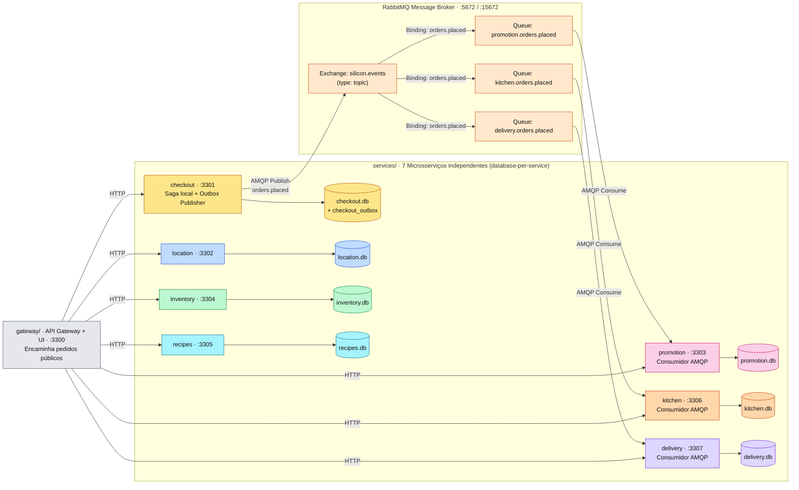
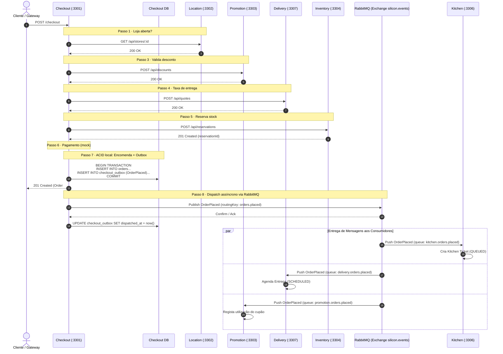

# Silicon Sandwiches · Event-Driven Architecture (RabbitMQ)

O mesmo sistema, com **sete microsserviços desacoplados através de Event-Driven Architecture (EDA)** utilizando um message broker **RabbitMQ** (com fallback automático in-memory para desenvolvimento ágil e testes unitários).

| Serviço | Pasta | Base de dados | Porta | Chamadas síncronas (HTTP) | Eventos Consumidos (RabbitMQ AMQP) |
|---|---|---|---|---|---|
| Checkout | `services/checkout/` | `data/checkout.db` | 3301 | Location, Promotion, Delivery, Inventory | *(Publica `OrderPlaced` via Outbox)* |
| Location | `services/location/` | `data/location.db` | 3302 | — | — |
| Promotion | `services/promotion/` | `data/promotion.db` | 3303 | — | Fila `promotion.orders.placed` (`orders.placed`) |
| Inventory | `services/inventory/` | `data/inventory.db` | 3304 | Recipes | — |
| Recipes | `services/recipes/` | `data/recipes.db` | 3305 | — | — |
| Kitchen | `services/kitchen/` | `data/kitchen.db` | 3306 | — | Fila `kitchen.orders.placed` (`orders.placed`) |
| Delivery | `services/delivery/` | `data/delivery.db` | 3307 | — | Fila `delivery.orders.placed` (`orders.placed`) |
| API Gateway | `gateway/` | — | 3300 | Todos (encaminhamento público) | — |

---

## 1. Como executar o RabbitMQ via Docker

Um ficheiro `docker-compose.yml` está incluído nesta pasta para iniciar o contentor RabbitMQ local com consola de gestão:

```powershell
docker compose up -d
# ou
npm run rabbit:up
```

- **AMQP Broker**: `amqp://localhost:5672`
- **Management UI**: `http://localhost:15672` (login: `guest` / password: `guest`)

Para parar o contentor:
```powershell
npm run rabbit:down
```

> **Zero setup / Modo sem contentor:** Caso o RabbitMQ não esteja a correr ou a biblioteca `amqplib` não esteja instalada, o sistema ativa automaticamente um **emulador AMQP completo in-memory** (`platform/rabbitmq.ts`), garantindo que `npm test`, `npm run demo` e `npm start` funcionam imediatamente.

---

## 2. Comandos de Arranque

Node **22.13 ou superior** (executa TypeScript nativamente sem compilação prévia via `--experimental-strip-types`):

```powershell
cd typescript/event-driven
npm start           # arranca os 8 processos; interface web em http://localhost:3300
npm run demo        # 9 checkouts na consola, mostrando chamadas HTTP e eventos AMQP
npm test            # 13 testes (9 de sistema + 4 de resiliência e concorrência AMQP)
npm run check:arch  # fitness functions de arquitetura (imports, banco e filas)
npm run typecheck   # verificação estrita de tipos com tsc
npm run reset:db    # limpa as 7 bases de dados SQLite mantendo o catálogo
```

---

## 3. Diagramas de Arquitetura

Diagramas completos também disponíveis em [`spec/Arquitetura - Event-Driven.md`](spec/Arquitetura%20-%20Event-Driven.md).

### 3.1. Topologia e Particionamento



### 3.2. Fluxo do Checkout (Saga Orquestrada + Outbox Pattern)



---

## 4. O Checkout: Saga Orquestrada + Publicação AMQP via Outbox

1. **Passos 1 a 6 (Saga Orquestrada via HTTP):**
   - Valida a loja (`location`), calcula preços locais (`catalog`), verifica desconto (`promotion`), quota de entrega (`delivery`), reserva ingredientes (`inventory` → `recipes`), e cobra pagamento simulado.
   - Se o pagamento falhar, o Checkout executa uma transação de compensação libertando os ingredientes reservados (`inventory release`).

2. **Passo 7 (Outbox Pattern Atómico):**
   - O Checkout grava a encomenda e o evento `OrderPlaced` na mesma transação local SQLite na tabela `checkout_outbox`.

3. **Passo 8 (Publicação e Roteamento AMQP):**
   - O `eventPublisher.ts` despacha os eventos pendentes para a Topic Exchange `silicon.events` com routing key `orders.placed`.
   - As mensagens só são removidas do outbox após confirmação do broker (*at-least-once delivery*).
   - O broker RabbitMQ encaminha cópias para as filas duráveis com bindings independentes:
     - `kitchen.orders.placed`
     - `delivery.orders.placed`
     - `promotion.orders.placed`

4. **Consumidores Desacoplados e Idempotentes:**
   - Se o serviço Kitchen ou Delivery estiver temporariamente em baixo, o checkout é concluído com sucesso (201). Quando o serviço regressa, consome a mensagem persistida na fila e atualiza o estado sem perda de dados.
   - Cada consumidor garante idempotência através de chave única de encomenda (`order_id UNIQUE`).

---

## 5. Verificação das Regras: `npm run check:arch`

1. **Isolamento de Código:** Nenhum serviço importa código de outro serviço (apenas código próprio e `platform/`).
2. **Sidecar/Plataforma Neutra:** `platform/` e `gateway/` não importam código de domínio.
3. **Database-per-Service:** Cada serviço só acede às tabelas do seu respetivo `schema.sql`.
4. **Sem SQL no Gateway:** O API gateway apenas encaminha rotas públicas.
5. **Mapeamento de Mensagens:** Valida produtores outbox e subscrições de filas no RabbitMQ.
