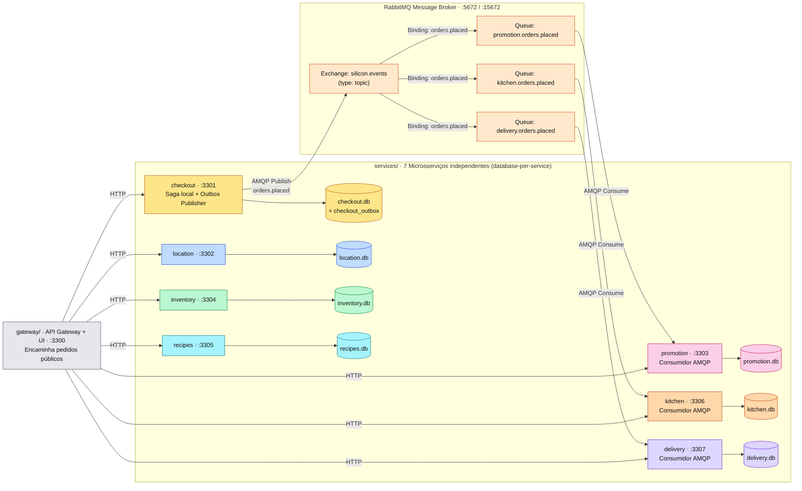
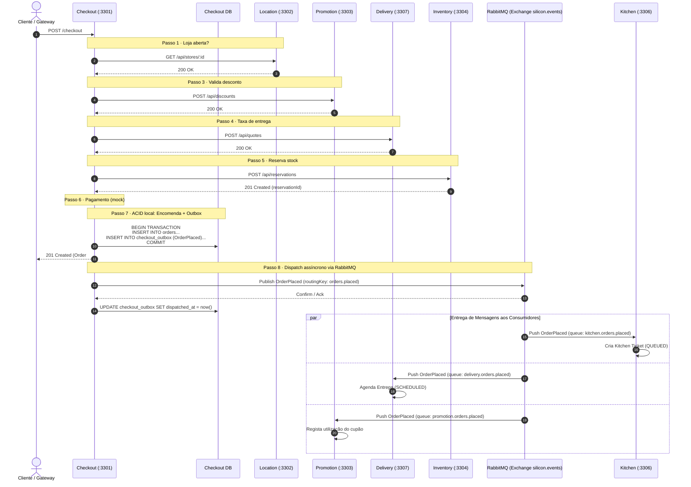

# Silicon Sandwiches · Event-Driven Architecture · Diagramas de Arquitetura

Vistas de arquitetura do novo exemplo `event-driven/`, comparando o desacoplamento por eventos via **RabbitMQ** com as versões anteriores.

---

## 1 · Topologia e Particionamento

O sistema mantém **sete microsserviços independentes** com **database-per-service** e um **API Gateway** na porta `3300`. A comunicação assíncrona entre o Checkout e os serviços consumidores (Kitchen, Delivery, Promotion) é realizada através de um **Message Broker RabbitMQ** local (porta `5672`) utilizando o padrão **Transactional Outbox**.

---

## 2 · Fluxo do Checkout (Saga Orquestrada + Outbox Pattern)

