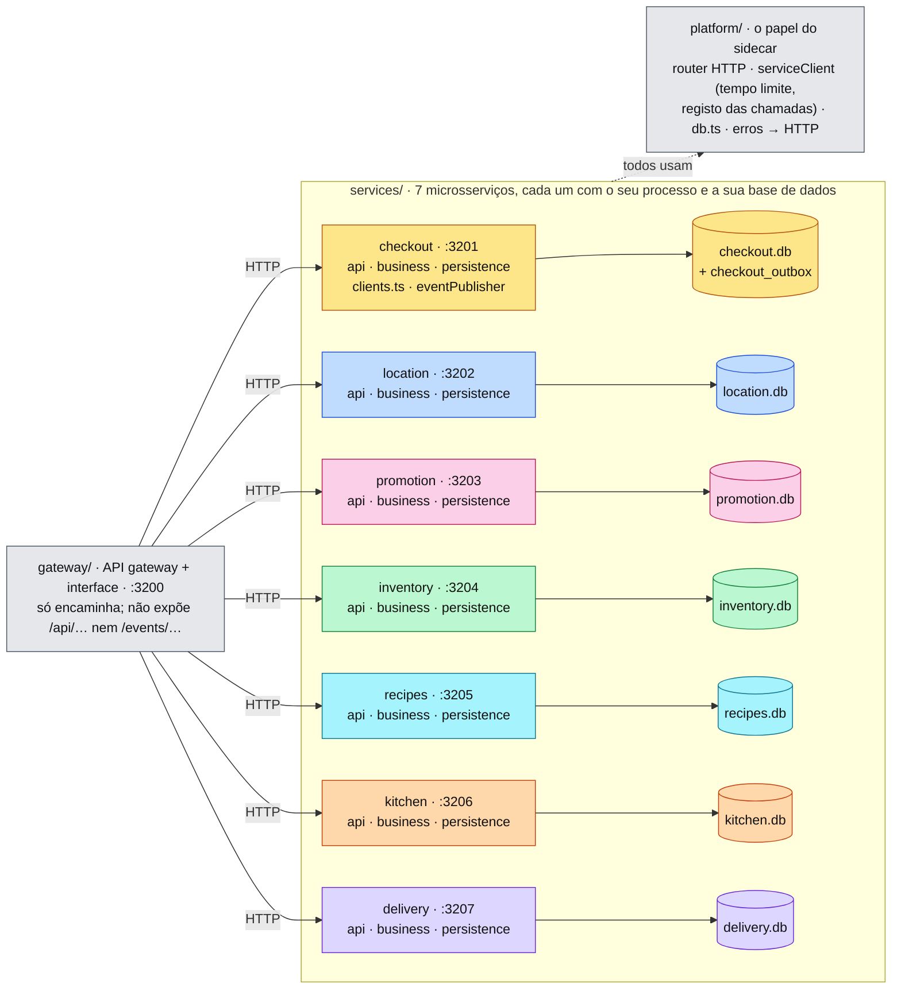
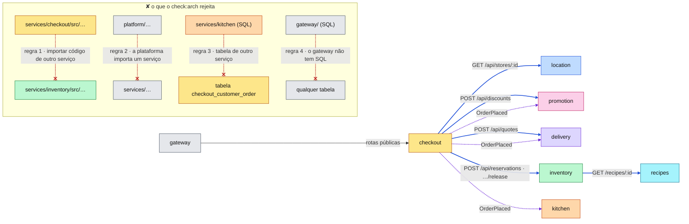
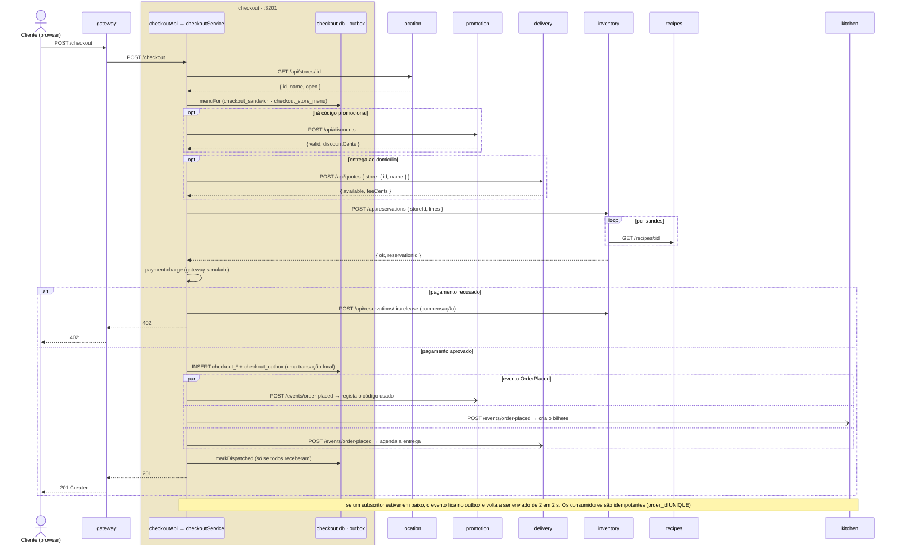
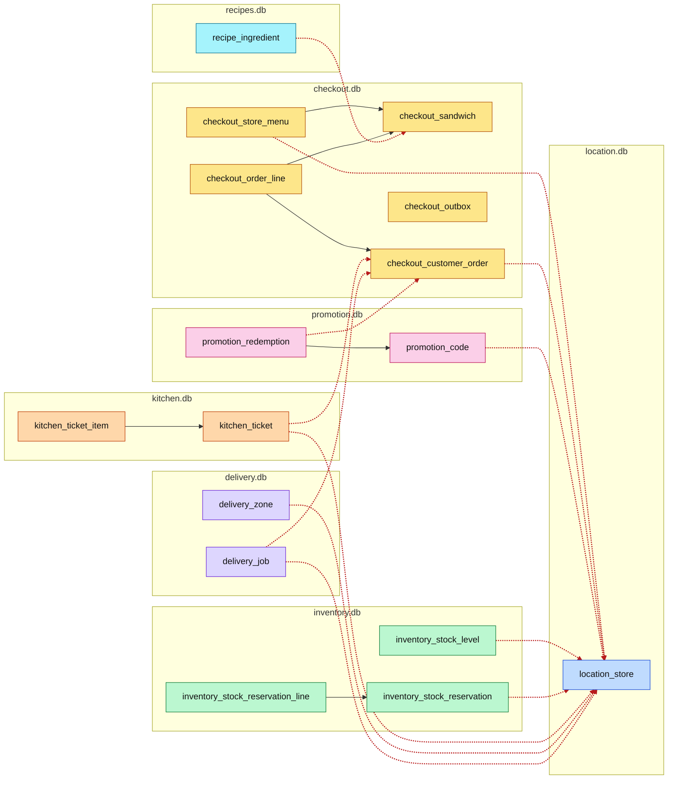

#fcul

# Silicon Sandwiches · Microservices · diagramas de arquitetura

Quatro vistas do código em `microservices/`, na mesma ordem e com as mesmas cores de [Arquitetura - Modular](../../modular/spec/Arquitetura%20-%20Modular.md) e [Arquitetura - Service-Based](../../service-based/spec/Arquitetura%20-%20Service-Based.md), para as comparar lado a lado. O código de cada serviço vem do módulo correspondente do `modular/`.

- **Mermaid** (esta nota): vê-se diretamente no Obsidian, no GitHub e no VS Code.
- **draw.io**: `Arquitetura - Microservices.drawio`, nesta pasta, com as mesmas quatro vistas em quatro páginas. É a versão para editar.

**Cor = componente do kata**, igual em todas as versões. Aqui, cada cor é um serviço:

| Cor | Componente | Serviço |
|---|---|---|
| 🟨 amarelo | CatalogCheckout | `services/checkout/` · :3201 |
| 🟦 azul | Location | `services/location/` · :3202 |
| 🩷 rosa | Promotion | `services/promotion/` · :3203 |
| 🟩 verde | ManageInventory | `services/inventory/` · :3204 |
| 🩵 ciano | Recipes | `services/recipes/` · :3205 |
| 🟧 laranja | MakeOrder | `services/kitchen/` · :3206 |
| 🟪 roxo | Delivery | `services/delivery/` · :3207 |
| ⬜ cinzento | técnico / partilhado | `gateway/` · :3200 e `platform/` |

---

## 1 · Particionamento de topo

O corte é **um serviço por componente do kata**. Cada serviço corre no seu processo, tem a sua `api/` HTTP, o seu `business/` e o seu `persistence/`, e é dono da sua **base de dados** (*database-per-service*). Os clientes só entram pelo **gateway**, que também serve a interface. `platform/` faz o papel do *sidecar*: o que é operacional e igual em todos os serviços, sem código de domínio.

Nenhum serviço importa código de outro. O que cada um precisa de saber dos outros vem pela rede, só com os campos necessários: o evento `OrderPlaced`, por exemplo, leva os nomes das sandes, para a cozinha não ter de perguntar ao Checkout. Duplica-se em vez de partilhar.

> **Perguntar:** "No `service-based/` havia quatro serviços e uma base de dados. Aqui há sete e sete. O que se ganhou?" → Cada serviço implanta-se, escala e falha à parte, e muda o seu esquema sem pedir licença a ninguém. O preço vê-se nas vistas seguintes: pedidos de rede em cada checkout, compensações em vez de `ROLLBACK`, um *outbox* e consumidores idempotentes.

---

## 2 · Regras de dependência

Não há imports entre serviços: o acoplamento é **dinâmico**, pela rede. O Checkout chama quatro serviços por HTTP, de forma síncrona (saga orquestrada pelo próprio Checkout), e no fim publica o evento `OrderPlaced`, a que três serviços reagem por si (coreografia). O mapa é o que o `check:arch` mostra no fim, lido dos clientes HTTP de cada serviço.

O gateway encaminha também as outras rotas públicas para o serviço dono de cada uma (lojas, stock, receitas, cozinha, entregas); não estão desenhadas.

As quatro regras de `scripts/check-architecture.ts` (`npm run check:arch`):

1. Um serviço não importa código de outro serviço: só o seu e o de `platform/`.
2. A plataforma e o gateway não importam código de nenhum serviço.
3. Cada serviço só usa as tabelas do seu `schema.sql`.
4. O gateway não tem SQL.

> **Perguntar:** "Que serviços são críticos para vender?" → Os que estão nas setas azuis: Location, Promotion, Delivery, Inventory e Recipes. Se um deles não responder, o checkout falha com 503. Os das setas roxas (Kitchen, Delivery, Promotion, como subscritores) podem estar em baixo: o evento espera no *outbox*.

---

## 3 · Sequência do checkout

Os mesmos oito passos de sempre, mas cada passo é agora um pedido HTTP a outro serviço, com a sua base de dados. **Passos 1 a 6: orquestração.** Como não há uma transação que abranja os serviços, um pagamento recusado obriga a uma **transação de compensação** no Inventory (*Saga*). **Passos 7 e 8: *outbox* e coreografia.** A encomenda e o evento são gravados na mesma transação local; depois o evento é enviado aos subscritores, que reagem por si.

> **Perguntar:** "Quantos pedidos de rede faz um checkout com entrega, promoção e duas sandes diferentes?" → Do Checkout: Location, Promotion, Delivery e Inventory (4); do Inventory ao Recipes, um por sandes (2); o evento para três subscritores (3); mais a entrada pelo gateway. Pelo menos dez, contra zero entre serviços no `service-based/`. `npm run demo` mostra-os todos nas linhas `[http]`.

---

## 4 · Dados

**Sete bases de dados**, uma por serviço, com as mesmas 15 tabelas do `modular/` mais o `checkout_outbox` (16). As 6 chaves estrangeiras ficam dentro de cada serviço. As 12 referências entre componentes atravessam agora bases de dados: são ids guardados, que nenhuma consulta pode verificar (a vermelho). As contagens são minhas, feitas a partir dos `schema.sql`.

| | Modular | Service-Based | Microservices |
|---|---|---|---|
| Bases de dados | 1 | 1, com 5 partições | 7 |
| Tabelas | 15 | 15 | 16 (+ `checkout_outbox`) |
| Chaves estrangeiras | 6 | 6 | 6 |
| Referências que atravessam bases de dados | 0 | 0 | 12 |
| Pagamento recusado | compensação (`release`) | `ROLLBACK` | compensação por HTTP |

> **Perguntar:** "O `BEMVINDO` só pode ser usado uma vez por cliente, mas a utilização só é registada quando o `OrderPlaced` chega ao Promotion. O mesmo cliente consegue usá-lo duas vezes?" → Sim, se fizer o segundo checkout antes de o evento do primeiro chegar (por exemplo, com o Promotion lento ou em baixo). É o custo da consistência eventual. No `service-based/`, a utilização é gravada na mesma transação da encomenda.
