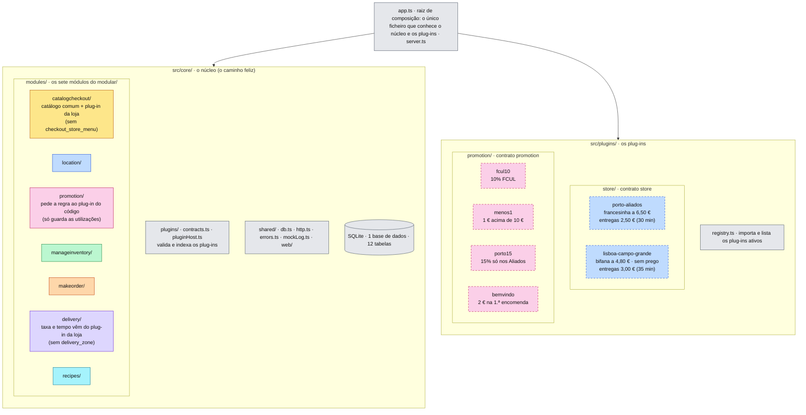
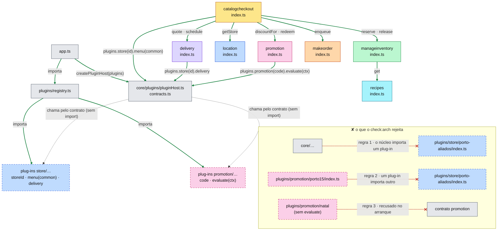
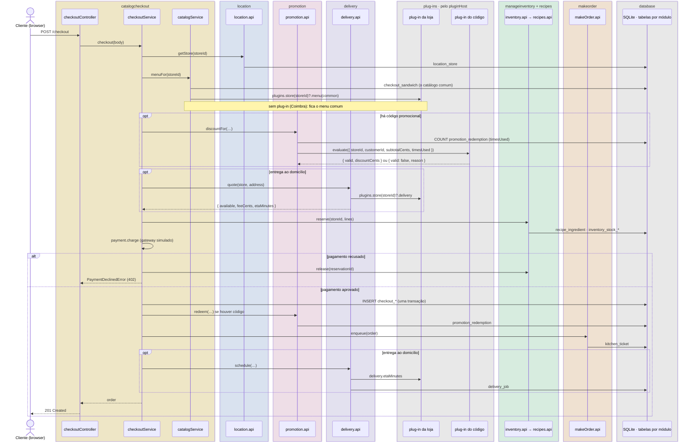
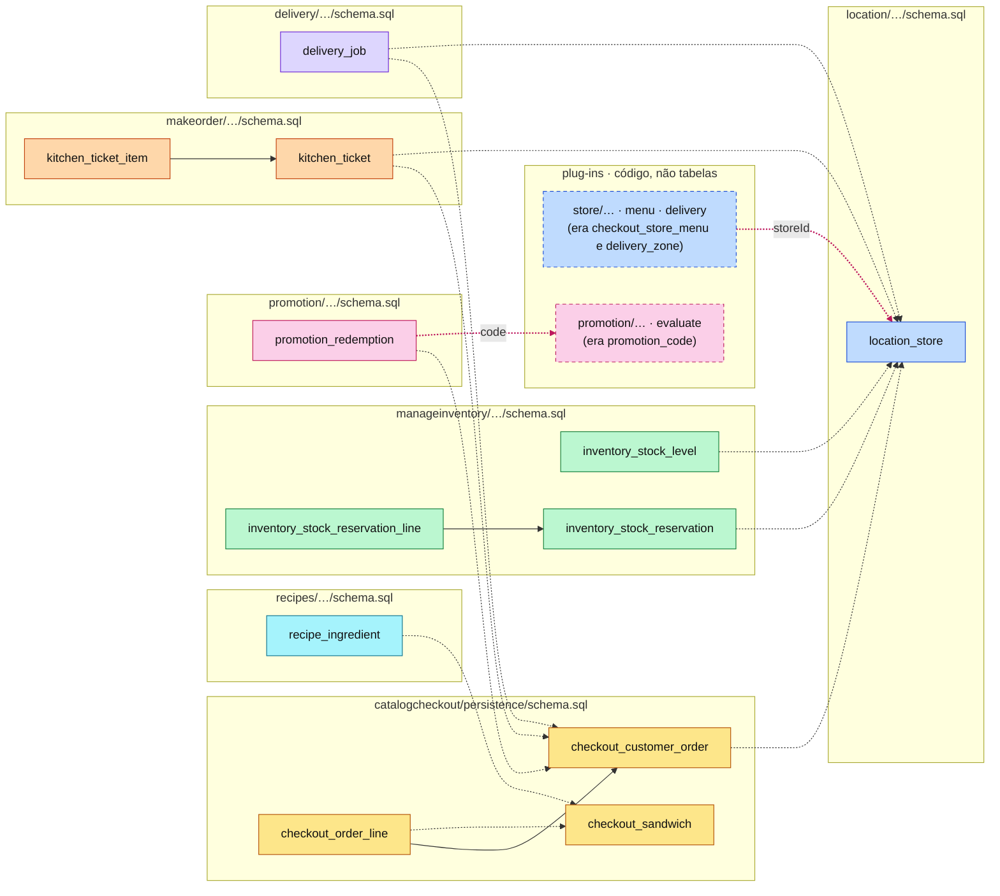

#fcul

# Silicon Sandwiches · Microkernel · diagramas de arquitetura

Quatro vistas do código em `microkernel/`, na mesma ordem e com as mesmas cores de [Arquitetura - Modular](../../modular/spec/Arquitetura%20-%20Modular.md), para as comparar lado a lado. O núcleo é o `modular/`; o que varia por loja e por código promocional saiu para plug-ins.

- **Mermaid** (esta nota): vê-se diretamente no Obsidian, no GitHub e no VS Code.
- **draw.io**: `Arquitetura - Microkernel.drawio`, nesta pasta, com as mesmas quatro vistas em quatro páginas. É a versão para editar.

**Cor = componente do kata**, igual em todas as versões:

| Cor | Componente / módulo |
|---|---|
| 🟨 amarelo | CatalogCheckout · `catalogcheckout/` |
| 🟦 azul | Location · `location/`, e os plug-ins de loja (`store/…`, a tracejado) |
| 🩷 rosa | Promotion · `promotion/`, e os plug-ins de promoção (`promotion/…`, a tracejado) |
| 🟩 verde | ManageInventory · `manageinventory/` |
| 🟧 laranja | MakeOrder · `makeorder/` |
| 🟪 roxo | Delivery · `delivery/` |
| 🩵 ciano | Recipes · `recipes/` |
| ⬜ cinzento | técnico / partilhado |

Um plug-in de loja personaliza uma loja: o menu (que o CatalogCheckout usa) e as entregas (que o Delivery usa). Fica a azul porque é "da loja", não de um destes dois componentes.

---

## 1 · Particionamento de topo

O primeiro corte é entre **núcleo** e **plug-ins**. O núcleo (`src/core/`) faz o caminho feliz e é, por dentro, um monólito modular com os sete módulos do `modular/`. Os plug-ins (`src/plugins/`) isolam o que muda muito: o menu e as entregas de cada loja, e a regra de cada código promocional. Só `app.ts` conhece os dois lados.

Coimbra não tem plug-in: vende o menu comum e não faz entregas. É o caminho feliz. Continua a ser um só processo com uma só base de dados: um único *quantum*, como no `modular/`.

> **Perguntar:** "A Silicon Sandwiches abre uma loja em Braga com um prato próprio. Onde se mexe?" → Cria-se `src/plugins/store/braga/index.ts` e junta-se uma linha a `registry.ts`. O núcleo não muda. Se a loja não tiver nada de especial, nem isso: sem plug-in, vende o menu comum.

---

## 2 · Regras de dependência

O núcleo **não importa** plug-ins, e os plug-ins **não importam** nada fora da sua pasta: nem o núcleo, nem outros plug-ins. Quem os junta é `app.ts`, que entrega o registo ao `pluginHost`. A partir daí, os módulos do núcleo procuram o plug-in pela loja ou pelo código e chamam-no pelo contrato, sem nenhum `if (loja === 'porto')`.

As quatro regras de `scripts/check-microkernel.ts` (`npm run check:arch`):

1. O núcleo (`src/core/`) não importa nada de `src/plugins/`.
2. Um plug-in só importa ficheiros da sua pasta: não depende do núcleo nem de outros plug-ins.
3. Todos os plug-ins estão no registo e cumprem o contrato (`contracts.ts`).
4. Dentro do núcleo, as regras do `modular/`: um módulo só usa outro pelo `index.ts` e só usa as suas tabelas.

> **Perguntar:** "O `BEMVINDO` só vale na primeira encomenda. Como sabe quantas vezes o cliente já o usou, se os plug-ins não acedem à base de dados?" → O núcleo conta as utilizações na tabela `promotion_redemption` e passa o número ao plug-in (`timesUsed`). O plug-in decide só com o que recebe, e por isso testa-se sozinho, sem núcleo nem base de dados.

---

## 3 · Sequência do checkout

O `checkoutService.ts` é igual ao do `modular/`: os passos são os mesmos. A diferença está **dentro** de três módulos do núcleo, que perguntam aos plug-ins o que antes liam de tabelas: o menu da loja, a regra do código e a taxa de entrega.

> **Perguntar:** "O núcleo sabe que existe uma loja no Porto?" → Não. Sabe que existe um plug-in com `storeId: 'porto-aliados'`, porque o `pluginHost` o indexou. O nome do Porto, a francesinha e a taxa de 2,50 € estão só no plug-in.

---

## 4 · Dados

**12 tabelas e 3 chaves estrangeiras**, todas dentro de um módulo. Saíram três tabelas do `modular/`, porque a personalização deixou de ser dados e passou a ser código: `checkout_store_menu` e `delivery_zone` foram para os plug-ins de loja, `promotion_code` para os plug-ins de promoção. A francesinha saiu do catálogo comum para o plug-in do Porto, por isso `checkout_order_line.sandwich_id` perdeu a FK para `checkout_sandwich`. As contagens são minhas, feitas a partir dos `schema.sql`.

| | Modular | Microkernel |
|---|---|---|
| Tabelas | 15 | 12 |
| Chaves estrangeiras | 6 | 3 |
| Menu local, zonas de entrega, códigos promocionais | linhas em tabelas | código, nos plug-ins |
| Criar um código promocional novo | um `INSERT` | um plug-in, um *deploy* |

> **Perguntar:** "Dados ou código: o que se ganhou e o que se perdeu?" → Ganhou-se poder escrever regras arbitrárias, que já não têm de caber nas colunas de `promotion_code` (percentagem, valor, mínimo, loja, limite por cliente), e testá-las uma a uma. Perdeu-se a possibilidade de o marketing criar um código sem um *deploy*, e a base de dados deixou de saber que códigos e que lojas com entrega existem.
