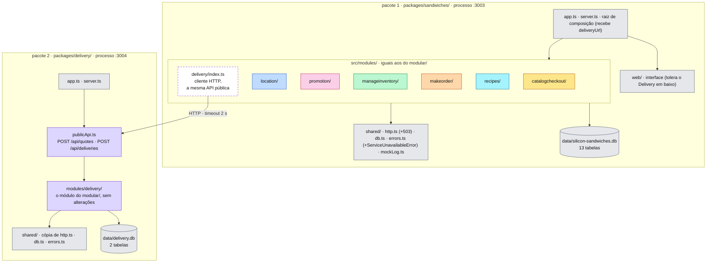
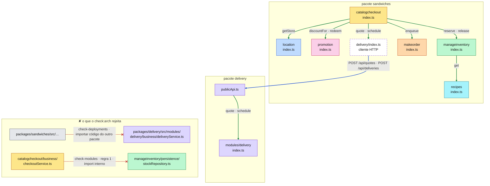
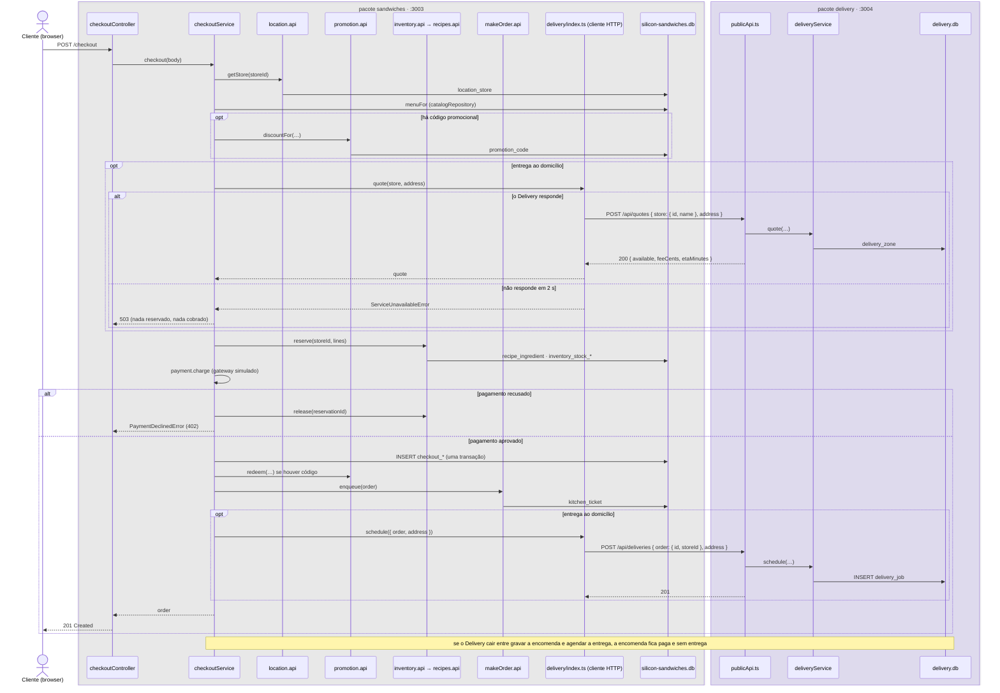
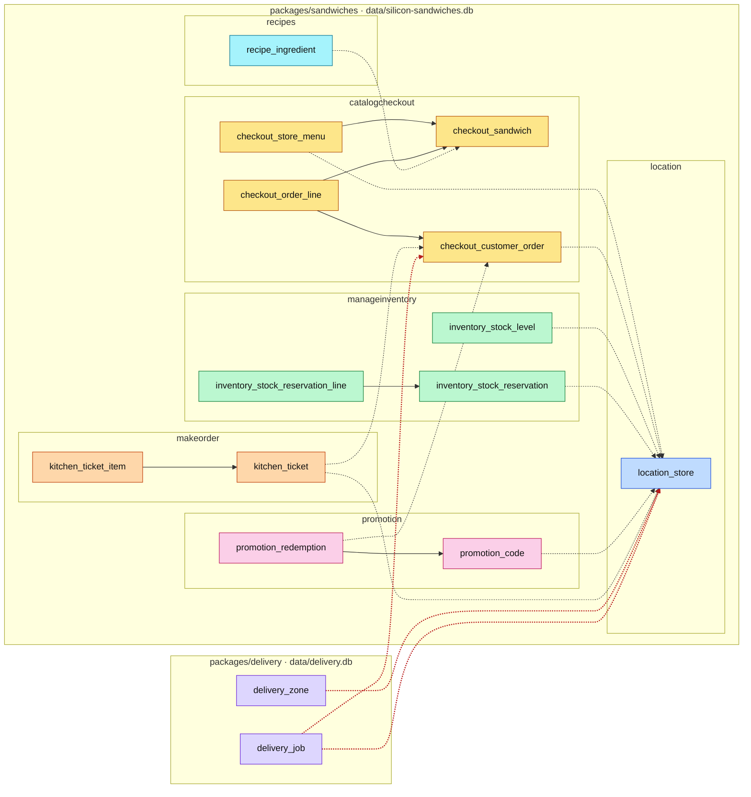

#fcul

# Silicon Sandwiches · Modular com dois pacotes de deployment · diagramas de arquitetura

Quatro vistas do código em `modular-with-two-packages/`, na mesma ordem e com as mesmas cores de [Arquitetura - Modular](../../modular/spec/Arquitetura%20-%20Modular.md), para as comparar lado a lado. O código é o do `modular/`; muda só onde corre o Delivery.

- **Mermaid** (esta nota): vê-se diretamente no Obsidian, no GitHub e no VS Code.
- **draw.io**: `Arquitetura - Modular com Dois Pacotes.drawio`, nesta pasta, com as mesmas quatro vistas em quatro páginas. É a versão para editar.

**Cor = componente do kata**, igual em todas as versões:

| Cor | Componente / módulo |
|---|---|
| 🟨 amarelo | CatalogCheckout · `catalogcheckout/` |
| 🟦 azul | Location · `location/` |
| 🩷 rosa | Promotion · `promotion/` |
| 🟩 verde | ManageInventory · `manageinventory/` |
| 🟧 laranja | MakeOrder · `makeorder/` |
| 🟪 roxo | Delivery · `delivery/` (a tracejado: o cliente HTTP que o substitui no pacote 1) |
| 🩵 ciano | Recipes · `recipes/` |
| ⬜ cinzento | técnico / partilhado |

---

## 1 · Particionamento de topo

O corte continua a ser **por domínio**, como no `modular/`, mas agora há um segundo nível acima dos módulos: **dois pacotes de deployment**. Cada um tem o seu `package.json`, o seu processo, a sua base de dados e a sua cópia de `shared/`. A pasta de topo (`scripts/` start-all · demo · check-deployments e `test/system.test.ts`) só junta o desenvolvimento e não é implantada.

| Pacote | Módulos | Base de dados | Porta |
|---|---|---|---|
| 1 · sandwiches | CatalogCheckout, Location, ManageInventory, Promotion, MakeOrder, Recipes + interface web | `packages/sandwiches/data/silicon-sandwiches.db` | 3003 |
| 2 · delivery | Delivery | `packages/delivery/data/delivery.db` | 3004 |

> **Perguntar:** "Quantos ficheiros do `modular/` mudaram para tirar o Delivery?" → Só a raiz de composição (`app.ts`, que passa a receber o `deliveryUrl`) e o `index.ts` do módulo Delivery no pacote 1, que passou a ser um cliente HTTP. O CatalogCheckout e o próprio módulo Delivery não mudaram. O que se acrescentou foi à volta: `publicApi.ts`, o `503` e a cópia de `shared/`.

---

## 2 · Regras de dependência

Há dois níveis de regras. **Entre pacotes**, nenhum importa código do outro: só falam por HTTP (`scripts/check-deployments.ts`). **Dentro do pacote sandwiches**, as três regras do `modular/` (`packages/sandwiches/scripts/check-modules.ts`). O CatalogCheckout continua a receber um `delivery` com `quote` e `schedule`; não sabe que do outro lado há uma rede.

`npm run check:arch`, na raiz:

1. Cada pacote tem o seu `package.json` (é implantável sozinho).
2. Nenhum pacote importa código de outro pacote: só falam por HTTP.
3. Dentro do sandwiches, as regras do `modular/`: um módulo só usa outro pelo `index.ts`, `shared/` não depende de módulos e cada módulo só usa as suas tabelas.

Pela rede só passam ids e valores simples: a encomenda vai como `{ id, storeId }`, não como o objeto completo.

> **Perguntar:** "Porque é que o `shared/` está copiado, e não partilhado?" → Se os dois pacotes importassem a mesma pasta, já não se podiam implantar à parte: a regra 2 falhava. Com dois pacotes de deployment, o código comum ou se copia ou se publica como biblioteca com versão.

---

## 3 · Sequência do checkout

A mesma sequência do `modular/`. A diferença está nas duas chamadas ao Delivery (passos 4 e 8), que agora atravessam a rede. A taxa de entrega é pedida **antes** de reservar o stock e de cobrar; por isso, com o Delivery em baixo, o checkout falha com 503 sem deixar nada a meio.

> **Perguntar:** "Quantos pedidos HTTP faz agora um checkout com entrega? E com levantamento na loja?" → Com entrega, dois entre os pacotes (`/api/quotes` e `/api/deliveries`); com levantamento, nenhum. Por isso, com o Delivery desligado, o levantamento continua a funcionar e só a entrega ao domicílio responde 503.

---

## 4 · Dados

As mesmas 15 tabelas e as mesmas 6 chaves estrangeiras do `modular/`, mas em **duas bases de dados**: 13 tabelas no pacote sandwiches e 2 no pacote delivery. Mudar as tabelas `delivery_*` de base de dados não partiu nenhuma FK, porque no `modular/` já não as tinham. Das 12 referências sem FK, 3 passam a atravessar bases de dados (a vermelho). As contagens são minhas, feitas a partir dos `schema.sql`.

> **Perguntar:** "O `store_id` das zonas de entrega está noutra base de dados. Quem garante que a loja existe?" → Ninguém, automaticamente. No `modular/` já era o código a garantir; agora nem sequer uma consulta o pode verificar, porque as tabelas estão em processos diferentes. O Delivery só sabe da loja o que o checkout lhe manda no pedido (`{ id, name }`).
