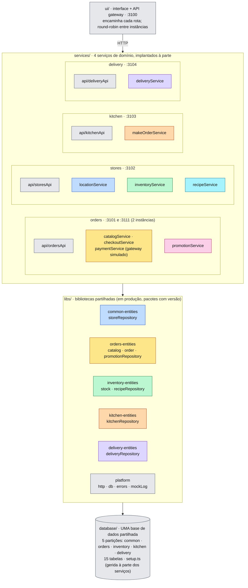
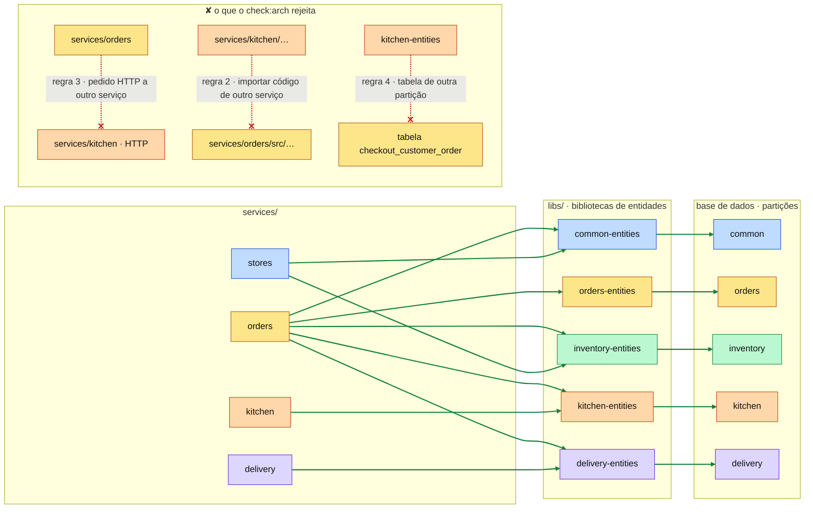
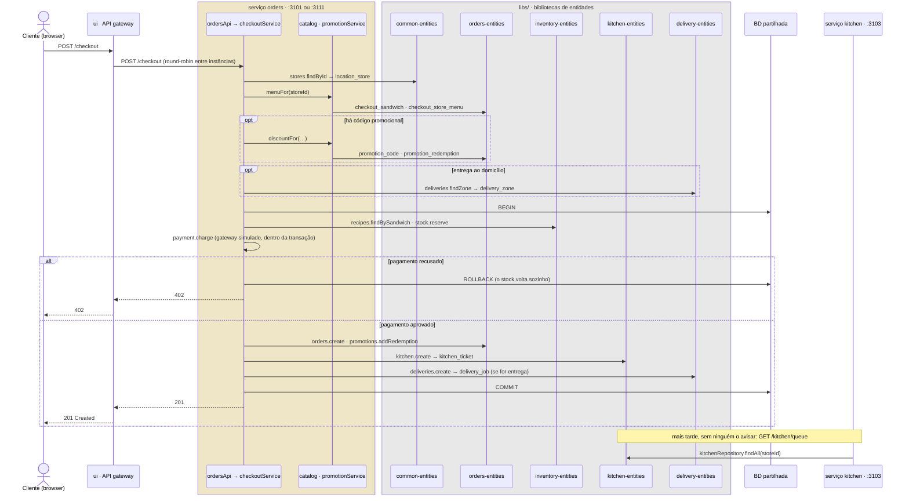
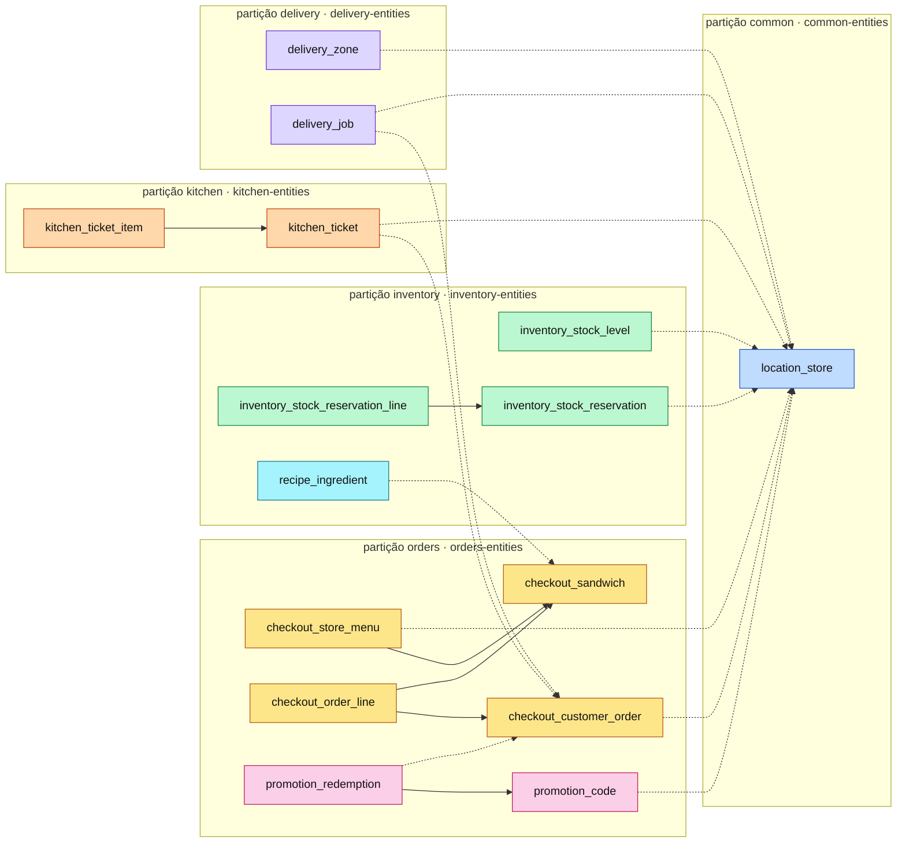

#fcul

# Silicon Sandwiches · Service-Based · diagramas de arquitetura

Quatro vistas do código em `service-based/`, na mesma ordem e com as mesmas cores de [Arquitetura - Layered](../../layered/spec/Arquitetura%20-%20Layered.md) e [Arquitetura - Modular](../../modular/spec/Arquitetura%20-%20Modular.md), para as comparar lado a lado.

- **Mermaid** (esta nota): vê-se diretamente no Obsidian, no GitHub e no VS Code.
- **draw.io**: `Arquitetura - Service-Based.drawio`, nesta pasta, com as mesmas quatro vistas em quatro páginas. É a versão para editar.

**Cor = componente do kata**, igual em todas as versões:

| Cor | Componente |
|---|---|
| 🟨 amarelo | CatalogCheckout |
| 🟦 azul | Location |
| 🩷 rosa | Promotion |
| 🟩 verde | ManageInventory |
| 🟧 laranja | MakeOrder |
| 🟪 roxo | Delivery |
| 🩵 ciano | Recipes |
| ⬜ cinzento | técnico / partilhado |

Aqui os serviços têm várias cores: um serviço de domínio de grão grosso junta vários componentes do kata.

---

## 1 · Particionamento de topo

O primeiro corte é por **serviços de domínio de grão grosso**: quatro, cada um implantado à parte, mais uma interface que é também o API gateway. Por dentro, cada serviço é uma pequena arquitetura em camadas (`api/` → `business/` → bibliotecas de entidades). Todos usam **uma só base de dados**, dividida em cinco partições lógicas, com uma biblioteca de entidades por partição.

| Serviço | Componentes do kata | Porta |
|---|---|---|
| Orders | CatalogCheckout, Promotion (+ gateway de pagamento simulado) | 3101 e 3111 |
| Stores | Location, ManageInventory, Recipes | 3102 |
| Kitchen | MakeOrder | 3103 |
| Delivery | Delivery | 3104 |
| `ui/` | interface + API gateway | 3100 |

> **Perguntar:** "No `modular/` havia sete módulos; aqui há quatro serviços. O que decidiu os agrupamentos?" → O que muda e escala junto. O checkout e as promoções andam sempre juntos (Orders); a loja, o seu stock e as receitas também (Stores). A cozinha e as entregas têm utilizadores e ritmos próprios, e ficaram sozinhas.

---

## 2 · Regras de dependência

Os serviços **não se chamam uns aos outros** nem importam código uns dos outros: integram-se **pela base de dados**. Só importam as bibliotecas de `libs/`, e só as bibliotecas de entidades têm SQL, cada uma na sua partição. O Orders importa as cinco bibliotecas de entidades, porque o checkout mexe em todas as partições.

As cinco regras de `scripts/check-architecture.ts` (`npm run check:arch`):

1. No máximo 12 serviços de domínio.
2. Um serviço (ou a interface) não importa código de outro serviço: só o seu e o de `libs/`.
3. Um serviço não faz pedidos HTTP a outro: a integração faz-se pela base de dados.
4. Só as bibliotecas de entidades têm SQL, e cada uma só usa as tabelas da sua partição.
5. Uma biblioteca só importa `libs/platform`.

Todos os serviços e a `ui/` importam também `libs/platform` (não desenhado). O `check:arch` termina com a **matriz de impacto**, que é o diagrama acima lido ao contrário:

| Se mudar a biblioteca… | é preciso testar e reimplantar |
|---|---|
| `common-entities` | orders, stores |
| `delivery-entities` | delivery, orders |
| `inventory-entities` | orders, stores |
| `kitchen-entities` | kitchen, orders |
| `orders-entities` | orders |
| `platform` | delivery, kitchen, orders, stores, ui |

> **Perguntar:** "Acrescenta-se uma coluna a `kitchen_ticket` (a nota "sem cebola"). Que serviços se reimplantam? E se fosse em `location_store`?" → `kitchen_ticket` está na partição *kitchen*: reimplantam-se o Kitchen e o Orders, que importam `kitchen-entities`. `location_store` está na partição *common*: o Orders e o Stores. O Orders aparece em todas as linhas da matriz.

---

## 3 · Sequência do checkout

`POST /checkout` entra pelo gateway, que escolhe uma das duas instâncias do Orders. O Orders **não chama nenhum outro serviço**: lê e escreve as tabelas de que precisa pelas bibliotecas de entidades. Os passos 5 a 8 são **uma só transação ACID**: se o pagamento for recusado, `ROLLBACK` e não fica nada a meio. Não há compensação.

> **Perguntar:** "A cozinha está em baixo. O checkout funciona?" → Sim. O Orders escreve o bilhete diretamente na tabela `kitchen_ticket`; quando o Kitchen volta, os bilhetes estão lá. O preço desta independência é o acoplamento pelos dados: o Orders tem de conhecer as tabelas da cozinha e das entregas.

---

## 4 · Dados

Uma só base de dados física com as **mesmas 15 tabelas e as mesmas 6 chaves estrangeiras do `modular/`**, repartidas por **cinco partições lógicas**, cada uma com o seu `schema.sql` em `database/<partição>/` e a sua biblioteca de entidades. As FK ficam dentro de cada partição; as 12 referências entre partições são ids guardados, sem FK (a tracejado). As contagens são minhas, feitas a partir dos `schema.sql`.

Uma partição não é um componente: `recipe_ingredient` (Recipes) está na partição *inventory* e `promotion_*` (Promotion) na partição *orders*, porque andam com o serviço que as usa.

> **Perguntar:** "Quantos *quanta* tem este sistema? E se o Delivery passasse a ter a sua própria base de dados?" → Um: os quatro serviços dependem da mesma base de dados, e sem ela nada funciona. Com uma base de dados própria, o Delivery podia ser um segundo *quantum*, mas só se o Orders deixasse de escrever em `delivery_job` dentro da sua transação. Para isso teria de passar a chamá-lo (ou a avisá-lo), como no `microservices/`.
